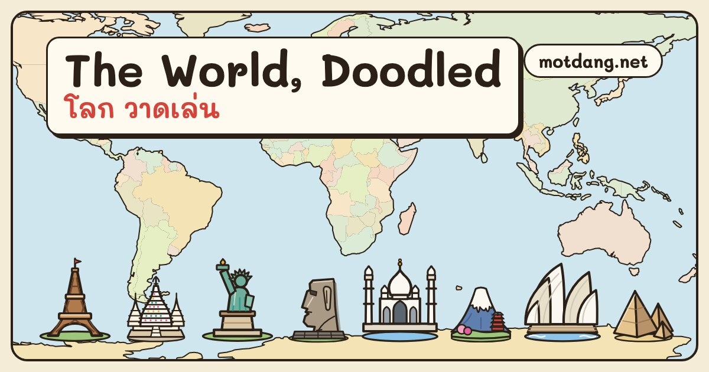

# Map Doodles · ภาพวาดสำหรับแผนที่



250 hand-drawn SVG marks for places anywhere on earth: **115 landmarks** drawn as themselves (the Eiffel Tower, the moai of Rapa Nui, Wat Arun, the Taj Mahal…) and **135 kinds of place** (wat, spirit house, songthaew, lighthouse, mosque, fuel station…). Made for the maps of [Mot Dang](https://motdang.net), a city guide to Chiang Mai and Chiang Rai.

All of them on a world map and in a gallery: **https://motdang.net/sites/map-doodles/**

## Use one

```html

```

Each drawing is 64 × 64 and stands on its bottom centre (32, 60), which is the map point: in MapLibre or Leaflet, anchor the icon at the bottom.

```html
<script src="https://cdn.jsdelivr.net/gh/NaNoBotCo/map-doodles@main/map-doodles.js"></script>
<script>
MDDOODLES.ready().then(function () {
  MDDOODLES.match({amenity: 'place_of_worship', religion: 'buddhist'});   // 'buddhist-temple'
  MDDOODLES.match({wikidata: 'Q243'});                                     // 'eiffel-tower'
  MDDOODLES.draw(ctx, 'moai', x, y, 48);                                   // on a canvas, standing on (x, y)
  MDDOODLES.maplibre(map, ['moai']);   // then 'icon-image': 'md-doodle-moai', 'icon-anchor': 'bottom'
});
</script>
```

Also on [Wikimedia Commons](https://commons.wikimedia.org/wiki/Category:Mot_Dang_map_doodles) and the [Internet Archive](https://archive.org/details/motdang-map-doodles). The same files are served from motdang.net (`https://motdang.net/sites/map-doodles/svg/<id>.svg`), open to any site.

## Files

| file | what |
|---|---|
| `svg/<id>.svg` | one drawing per file |
| `map-doodles.svg` | all 250 as one sprite, symbols `d-<id>` |
| `map-doodles.json` | one row per drawing: `id`, `en`, `th`, `group` (landmark or kind), `region` or `set`, `osm` (the OpenStreetMap tags a place carries when this drawing fits it), and for landmarks `cc`, `city`, `lat`, `lng`, `wiki`, `wd` (Wikidata id) |
| `map-doodles.js` | the loader above |
| `index.html` | the gallery and world map as served on motdang.net |
| `data/world.json` | the world outline the map draws |

## Credit and licence

Drawings and data: [CC BY 4.0](LICENSE), credit **"NaN · Mot Dang (motdang.net)"**. Code (`map-doodles.js`): MIT. World outline: [Natural Earth](https://www.naturalearthdata.com/), public domain.

Drawn as SVG code by Claude (Anthropic) for Mot Dang, October 2026.

## ภาษาไทย

ภาพวาด 250 ภาพ สำหรับวางบนแผนที่ที่ไหนก็ได้ในโลก: สถานที่สำคัญ 115 แห่ง วาดให้เหมือนตัวจริง (หอไอเฟล โมอาย วัดอรุณ ทัชมาฮาล…) และสถานที่อีก 135 ประเภท (วัด ศาลพระภูมิ รถสองแถว ประภาคาร มัสยิด ปั๊มน้ำมัน…) ทำขึ้นสำหรับแผนที่ของ[มดแดง](https://motdang.net) ดูทั้งหมดบนแผนที่โลก: https://motdang.net/sites/map-doodles/

แต่ละภาพเป็นไฟล์ SVG ขนาด 64 × 64 ยืนบนจุดกึ่งกลางด้านล่าง ซึ่งคือจุดบนแผนที่ ใช้ได้ภายใต้สัญญาอนุญาต CC BY 4.0 โดยให้เครดิต "NaN · Mot Dang (motdang.net)" ส่วนโค้ดใช้สัญญาอนุญาต MIT
